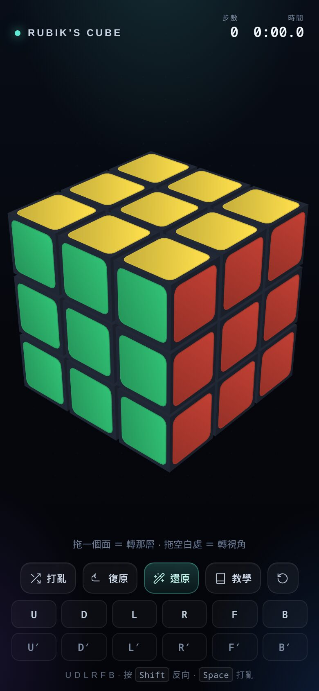
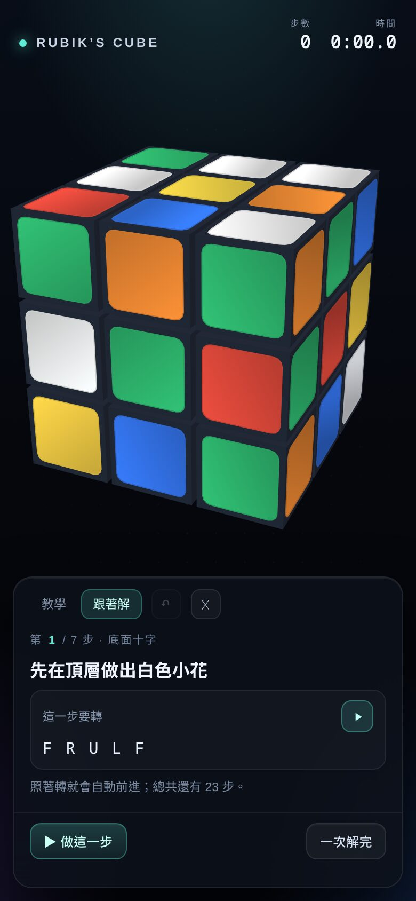

<div align="center">

# 3D 魔術方塊 · Rubik's Cube

**拖曳就能轉的 3D 魔術方塊，內建七步解法教學，還有會讀你手上這顆盤面的「跟著解」。**

單一個 HTML 檔 · 沒有 WebGL · 沒有任何相依套件

### [▶ 線上直接玩 →](https://stansu.github.io/rc/)


&nbsp;&nbsp;


</div>

---

## 功能

- **真的 3D，但不是 WebGL** — 自己寫的軟體渲染器：透視投影、畫家演算法排序、逐面打光。Canvas 2D 就能跑，老手機、WebView、不支援 WebGL 的瀏覽器都能開。
- **拖一個面就轉那一層** — 抓哪一塊就轉哪一層，中間層也可以。
- **拖空白處轉視角** — 在黑色背景上拖曳就能旋轉視角；滾輪或雙指捏合縮放，雙擊回到預設角度。
- **打亂 / 復原 / 還原 / 計時** — 步數與時間自動計算，完成時有慶祝提示。
- **教學** — 層先法七步，每一步的公式都能直接在方塊上播放示範，看不懂就再播一次。
- **跟著解** — 讀目前的盤面，告訴你「現在這一步該轉什麼」，可以單步跟，也可以一次解完；中途自己亂轉它會重算。
- **手機優先** — 390 / 360 寬的螢幕都剛好塞得下。
- **鍵盤操作** — `U D L R F B` 轉面（按 `Shift` 反向）、`Space` 打亂、`Z`／`Backspace` 復原。

## 怎麼玩

| 操作 | 動作 |
| --- | --- |
| 拖曳貼紙 | 轉動那一層（含中間層） |
| 拖曳黑色空白處、雙指拖曳 | 旋轉視角 |
| 滾輪、雙指捏合 | 縮放 |
| 雙擊畫面 | 回到預設視角 |
| 鍵盤 `U D L R F B` | 轉對應的面，加 `Shift` 反向 |
| 鍵盤 `Space` / `Z` | 打亂／復原 |

畫面下方按鈕：**打亂**（隨機 22 步）、**復原**（退一步）、**還原**（倒帶所有步數回到完成狀態）、**教學**、**重設**（方塊與計時歸零）。

教學面板分成兩種模式：

- **教學** — 七步層先法，每條公式都可以按播放鍵看它在方塊上跑一遍。
- **跟著解** — 讀目前盤面算出解法，逐步提示；按「做這一步」跟著轉，或按「一次解完」讓它自己跑完。

## 線上玩

<https://stansu.github.io/rc/>

## 本機使用

下載 [`index.html`](index.html)，**直接用瀏覽器打開就好**（不用伺服器、不用安裝、離線可用）。

```bash
git clone https://github.com/stansu/rc.git
cd rc
xdg-open index.html   # macOS 可用 open index.html
```

想放到網路上，丟到任何靜態網站空間即可，它就是一個檔案。

## 部署到 GitHub Pages

1. 把這個資料夾推上 GitHub。
2. repo → **Settings → Pages** → Source 選 **Deploy from a branch** → 分支 `main`、資料夾 `/ (root)` → Save。
3. 等一分鐘，網址會是 `https://<你的帳號>.github.io/<repo>/`。

這個 repo 已經部署在 <https://stansu.github.io/rc/>。

## 流量統計

使用 [GoatCounter](https://www.goatcounter.com/)：無 cookie、不蒐集個資，只用來知道有多少人開過頁面、多少人真的開始玩。Dashboard 在 <https://stansu-rc.goatcounter.com/>。

`index.html` 裡的 `ANALYTICS_ENDPOINT` 指向 `https://stansu-rc.goatcounter.com/count`。若不想統計，把它改成空字串 `""` 即可；此時不會載入任何外部程式，也不會發出任何請求。

會記錄的遊玩事件（同一次瀏覽只算一次 `played`）：

| 事件 | 時機 |
| --- | --- |
| `played` | 第一次實際轉動方塊 |
| `scramble` | 按下打亂 |
| `tutorial` | 開啟教學 |
| `solve-tab` | 切到「跟著解」 |
| `solved` | 完成復原 |

廣告封鎖器會擋掉一部分請求，所以數字看趨勢即可，不會是精確人次。

## 技術筆記

**渲染** — 每個方塊用 3×3 整數旋轉矩陣記錄姿態（轉動永遠是 90° 的倍數，所以不會累積誤差）。畫的時候把 26 個小方塊的 6 個面投影到螢幕，背面剔除後依深度排序、由遠而近填色；貼紙是圓角矩形的多邊形，跟著同一個投影走，所以透視是正確的。

**互動** — 指標按下時，從眼睛射出一條射線，跟每個小方塊的包圍盒求交，決定抓到哪個面、哪一層；再把拖曳方向投影回螢幕，決定順時針或逆時針。射線沒打中任何方塊時才進入 orbit 模式，拖曳改成旋轉相機。

**解算** — 層先法（底面十字 → 第一層角塊 → 中層邊塊 → 頂面十字 → 頂面全黃 → 頂角歸位 → 頂邊歸位）。
前三步用「小花」加上有界搜尋；後四步是「轉一下頂層 + 套公式」，用迭代加深搜尋找出最短的套用次數。
所有公式都不是憑印象寫的：用引擎逐條驗證過（例如「頂角歸位」那條必須是純換角、不翻面、不動下面兩層）。

**驗證** — 解算器跑過 200 顆隨機盤面，200/200 解得開，平均 160 步上下，每次計算約 60 毫秒。

**開發者 API** — 瀏覽器 console 裡有 `window.Rubiks` 可以玩：

```js
Rubiks.turn("R'");       // 轉一個面（標準轉動代號）
Rubiks.scramble();       // 打亂
Rubiks.solve();          // 倒帶回完成狀態
Rubiks.state();          // 目前盤面、步數、佇列狀態
```

## 專案結構

```
index.html     整站（HTML + CSS + JS 全部內嵌，約 73 KB）
docs/          README 用的截圖
LICENSE        MIT 授權
```

## 授權

[MIT](LICENSE) © stansu
